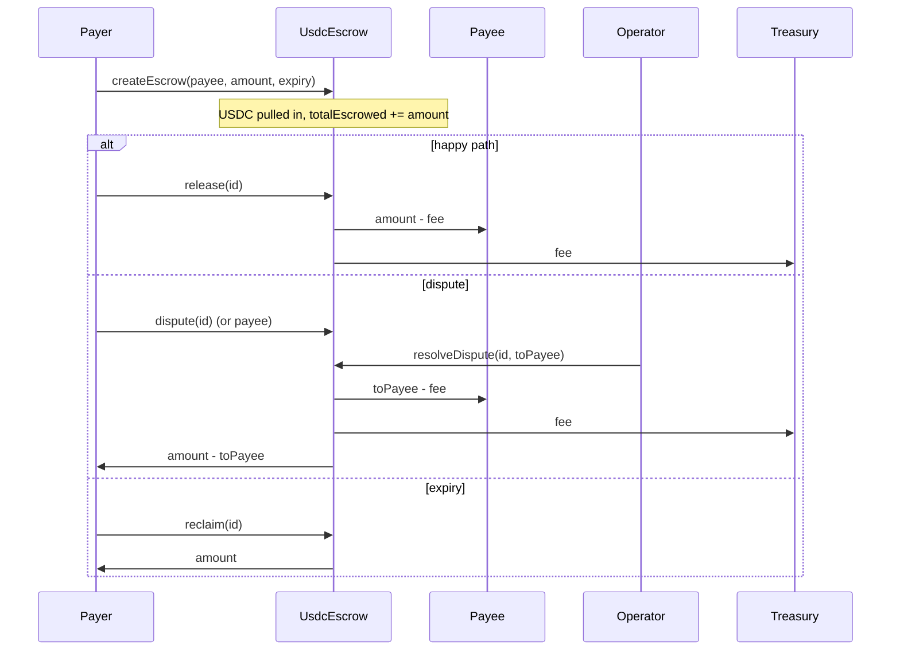

# UsdcEscrow: Design Doc

## 1. Metadata
- Status: Draft (awaiting your confirmation)
- Target chain: Arc Testnet (chain id 5042002). USDC ERC-20 at `0x3600000000000000000000000000000000000000`, 6 decimals.
- Language / toolchain: Solidity ^0.8.28, Foundry, OpenZeppelin Contracts (installed version).
- Upgradeability: none (immutable).
- Review tracker: [ ] Design  [ ] Security  [ ] Ops

## 2. Action Items (living)
- Confirm admin / operator / pauser addresses (see 12, Deployment).
- Supply treasury address before enabling a fee.

## 3. Goals / Non-Goals
Goals
- A payer locks USDC for a payee. The payer releases it to the payee.
- If the parties disagree, an operator resolves the dispute.
- Immutable, minimal, with separated admin, operator and pauser roles.
- Optional protocol fee (bps) paid to a treasury on amounts paid to payees.

Non-Goals
- No minting or burning. The contract only holds existing USDC.
- No upgradeability, no multi-token support, no off-chain signatures, no UI.
- No arbitration logic beyond an operator choosing a split.

## 4. Requirements
Functional
- F1 Payer creates an escrow for a payee with amount and expiry.
- F2 Payer releases the escrow to the payee (minus fee).
- F3 Payer or payee opens a dispute while the escrow is active.
- F4 Operator resolves a dispute with an exact split between payee and payer.
- F5 After expiry with no dispute, the payer reclaims the funds.
- F6 If a dispute is not resolved within the resolution window, either party can trigger a refund to the payer.
- F7 Payee can voluntarily refund the payer at any time.
- F8 Pauser pauses. Admin unpauses, sets fee and treasury, manages roles.

Security (testable assertions)
- S1 USDC balance of the contract >= sum of all active escrow amounts (`totalEscrowed`).
- S2 Each escrow is settled at most once. Status moves only Active -> Disputed -> Settled, or Active -> Settled.
- S3 No role (admin, operator, pauser) can move escrowed funds except the operator's dispute split, which can only pay the escrow's own payer and payee.
- S4 The fee applied to an escrow is the fee at creation time, capped at `MAX_FEE_BPS` (500 = 5%).
- S5 The pauser cannot unpause. While paused, no USDC leaves or enters the contract.
- S6 Only the escrow's payer can release.

## 5. Terminology and Actors
| Actor | On/off chain | Trust | Powers |
| --- | --- | --- | --- |
| Payer | either | untrusted | create, release, dispute, reclaim after expiry |
| Payee | either | untrusted | dispute, refund payer |
| Operator | off-chain key | semi-trusted | resolve disputes only |
| Pauser | off-chain key | semi-trusted | pause only |
| Admin | multisig recommended | trusted | unpause, set fee/treasury, grant/revoke roles, rescue stray tokens |
| Treasury | address | passive | receives fees |

## 6. Language / Runtime
Solidity 0.8.x (checked arithmetic). EVM target as set in `foundry.toml`. Built on OpenZeppelin `AccessControlDefaultAdminRules`, `Pausable`, `ReentrancyGuard`, `SafeERC20`.

## 7. Transaction and Execution Model
Every call is atomic. External calls only touch the USDC token. All state is updated before the token transfer (checks-effects-interactions) and every fund-moving function is `nonReentrant`.

## 8. Chain Standards and Interfaces
ERC-20 (USDC). `AccessControlDefaultAdminRules` gives a two-step, delayed admin transfer and prevents renouncing to zero in one step. Arc note: native gas is also USDC, but this contract only uses the ERC-20 view and has no payable functions.

## 9. Architecture and Flow of Funds

| Step | Who moves what | Invariant |
| --- | --- | --- |
| create | payer -> contract, `amount` | balance delta == amount, totalEscrowed += amount |
| release | contract -> payee, treasury | payee + fee == amount, totalEscrowed -= amount |
| resolve | contract -> payee, treasury, payer | payeeNet + fee + refund == amount |
| reclaim / refund / expire | contract -> payer | refund == amount |

Resting-state invariant: USDC balance == totalEscrowed (plus any unsolicited donations, which only admin may sweep above `totalEscrowed`).

Dependencies: Arc USDC (Circle, can blocklist addresses).

## 10. Contract Design
### Roles
| Role | Holder at deploy | Permissions | Why |
| --- | --- | --- | --- |
| DEFAULT_ADMIN_ROLE | `admin` (single holder, 2-step transfer with delay) | unpause, setFee, setTreasury, grant/revoke OPERATOR and PAUSER, sweep surplus and stray tokens | governance |
| OPERATOR_ROLE | `operator` | resolveDispute | dispute handling, no other power |
| PAUSER_ROLE | `pauser` | pause | emergency stop, no other power |

### Storage
- `IERC20 immutable usdc`
- `uint16 public feeBps`, `address public treasury`
- `uint256 public nextId`, `uint256 public totalEscrowed`
- `mapping(uint256 => Escrow) escrows`
- `struct Escrow { address payer; address payee; uint128 amount; uint64 expiry; uint64 disputedAt; uint16 feeBps; Status status; }`
- `enum Status { None, Active, Disputed, Settled }`
- Constants: `MAX_FEE_BPS = 500`, `MIN_DURATION = 1 hours`, `MAX_DURATION = 365 days`, `DISPUTE_WINDOW = 30 days`, `MIN_AMOUNT = 1`.

### Modifiers
`whenNotPaused`, `nonReentrant`, `onlyRole(...)`.

### Write functions
| Function | Caller | State | Events | Reverts |
| --- | --- | --- | --- | --- |
| `createEscrow(payee, amount, duration)` | anyone, not paused | new Active escrow, `totalEscrowed += amount`, fee snapshot | `EscrowCreated` | payee zero or == payer or == this, amount 0, duration out of range, balance delta != amount |
| `release(id)` | payer, not paused | Settled, totalEscrowed -= amount | `EscrowReleased` | not payer, status != Active |
| `dispute(id)` | payer or payee (allowed while paused) | Disputed, disputedAt = now | `EscrowDisputed` | not party, status != Active |
| `resolveDispute(id, toPayee)` | OPERATOR, not paused | Settled; pays payee (minus fee), treasury, payer | `DisputeResolved` | status != Disputed, toPayee > amount |
| `reclaim(id)` | payer, not paused | Settled, refund payer | `EscrowRefunded` | not payer, status != Active, now <= expiry |
| `refundByPayee(id)` | payee, not paused | Settled, refund payer | `EscrowRefunded` | not payee, status is not Active/Disputed |
| `expireDispute(id)` | payer or payee, not paused | Settled, refund payer | `EscrowRefunded` | status != Disputed, now < disputedAt + DISPUTE_WINDOW |
| `pause()` | PAUSER | paused | `Paused` | already paused |
| `unpause()` | ADMIN | unpaused | `Unpaused` | not paused |
| `setFee(bps)` | ADMIN | feeBps | `FeeUpdated` | bps > MAX_FEE_BPS, or bps > 0 with zero treasury |
| `setTreasury(addr)` | ADMIN | treasury | `TreasuryUpdated` | zero address while feeBps > 0 |
| `sweepSurplus(to)` / `rescueToken(token, to, amount)` | ADMIN | moves only USDC above `totalEscrowed`, or non-USDC tokens | `Swept` / `Rescued` | to zero, nothing to sweep, token == usdc in rescueToken |

Fee: `fee = payeeAmount * escrow.feeBps / 10_000`, rounded down. If the fee snapshot is nonzero, treasury at settlement must be nonzero (guaranteed by setTreasury/setFee rules).

### Views
`getEscrow(id)`, `previewFee(amount)`, plus public config getters.

### Events
`EscrowCreated(id, payer indexed, payee indexed, amount, expiry, feeBps)`, `EscrowReleased(id, payee, net, fee)`, `EscrowDisputed(id, by)`, `DisputeResolved(id, operator, toPayee, net, fee, refund)`, `EscrowRefunded(id, payer, amount, reason)`, `FeeUpdated`, `TreasuryUpdated`, `Swept`, `Rescued`.

## 12. Deployment and Initialization
Constructor: `(usdc, admin, operator, pauser, adminDelay, treasury, feeBps)`. Arc Testnet USDC from the registry. Initial `feeBps = 0` and `treasury = address(0)` is valid, so no treasury address is needed at deploy. You enable fees later with `setTreasury` then `setFee`.

Runbook: deploy -> verify roles via reads -> (admin) set treasury and fee -> rotate roles to real keys.

Important: the platform deploy wallet is shared across Arc Studio users and you cannot sign from it. If admin, operator and pauser are set to that wallet, nobody on your side can ever unpause, set the fee or rotate roles. Use your own addresses for the three roles (or self-deploy from your own wallet).

## 13. Upgradeability
None. Migration story: deploy a new escrow, stop creating new escrows on the old one (pause), let existing escrows settle, re-point integrators.

## 14. Key Management and Signing
No signatures. Admin should be a multisig. Operator and pauser may be hot keys. The `adminDelay` protects admin transfer.

## 15. Security Considerations
| Vulnerability | Applicable? | Mitigation |
| --- | --- | --- |
| Reentrancy | Yes (token calls) | CEI + `nonReentrant` |
| Access control | Yes | roles table above, least privilege |
| Overflow | Checked 0.8; no `unchecked` | n/a |
| Unchecked return / odd tokens | Yes | `SafeERC20`, balance-delta check on deposit |
| Fee-on-transfer | Yes | revert if received != amount |
| Signature replay | No signatures | n/a |
| Front-running | Low | dispute vs reclaim race handled by expiry rules; payee should dispute before expiry |
| Oracles / flash loans | No | n/a |
| DoS | Yes | no loops, pull per escrow; USDC blocklisted payee reverts a release, payer disputes and operator refunds |
| Delegatecall / proxy | No | immutable |
| Timestamp | Yes | only coarse windows (hours, days) |
| Approval persistence | Yes | payer approves exact amount; contract never holds approvals |
| Centralization | Yes | operator can only split a dispute between the two parties; admin cannot touch escrowed funds |
| USDC blocklist / pause | Yes | documented; dispute path allows full refund |
| Forced USDC donation | Yes | tracked by `totalEscrowed`, surplus sweepable by admin only |

## 16. Trust Model and Threat Analysis
| Key | Worst case if compromised | Mitigation | Detection |
| --- | --- | --- | --- |
| Operator | Awards disputed escrows to one side (only disputed ones) | admin revokes role; payer/payee avoid disputes with high value; window-based refund if operator is absent | `DisputeResolved` alerts |
| Pauser | Freeze the contract (griefing) | admin unpauses; pauser cannot unpause or move funds | `Paused` alert |
| Admin | Unpause, change fee for new escrows (max 5%), change treasury, grant roles, add a malicious operator | multisig, delayed admin transfer, fee snapshot per escrow, cap on fee | role and fee events |
| Treasury | None, receives fees only | n/a | n/a |

## 17. Emergency Response
Pauser pauses. While paused: create, release, resolve, reclaim, refund, expire are blocked. `dispute` stays open so a party can protect themselves. Admin investigates, revokes roles if needed, unpauses. Expiries are not extended by a pause (documented limitation, kept simple on purpose).

## 18. Failure Scenarios
- USDC reverts on transfer to a blocklisted payee: release reverts, state unchanged. Payer disputes, operator resolves with `toPayee = 0`.
- Operator key lost: after `DISPUTE_WINDOW`, either party calls `expireDispute` and the payer is refunded. Funds are never permanently locked.
- Payer disappears: payee can dispute before expiry, or after expiry the payer's reclaim right remains, so the payee should dispute in time.
- Fee token behavior: any transfer that does not deliver the full amount reverts the whole call.

## 19. Priorities and Tradeoffs
| Decision | Tradeoff | Rationale / rejected |
| --- | --- | --- |
| Payer releases (your choice) | Payer can stall | expiry plus payee dispute bound the stall; rejected operator-releases |
| Refund payer after unresolved dispute window | Favors payer | rejected 50/50 (arbitrary) and permanent lock |
| Fee snapshot at creation | Fee changes do not apply to open escrows | protects counterparties from admin changes |
| No unpause for pauser | Slower recovery | prevents a compromised pauser toggling state |
| No native USDC handling | Cannot rescue forced native balance | contract holds ERC-20 view only |
| No receipt NFT | Less composable | you chose pure USDC escrow |

## 20. Testing Strategy
Foundry. Happy paths, every revert, events, role checks, pause behavior, fee rounding, fuzz on amounts and fee bps, invariants (balance >= totalEscrowed, settled escrows never reopen). Static analysis with Slither. Run: `forge test`.

## 21. Third-party Libraries
OpenZeppelin Contracts (already installed): `AccessControlDefaultAdminRules`, `Pausable`, `ReentrancyGuard`, `SafeERC20`.

## 22. Monitoring
Alert on `Paused`, `DisputeResolved`, `FeeUpdated`, `TreasuryUpdated`, role grant/revoke, and `Swept`.

## 23. Stakeholders
Contract owner (you) for roles and fee policy. A security review before any mainnet use.

## 26. Worked Example
Payer approves 100 USDC, calls `createEscrow(payee, 100e6, 14 days)` with fee 1% snapshot. Payer calls `release(id)`: payee receives 99 USDC, treasury 1 USDC, `totalEscrowed` returns to prior value.
